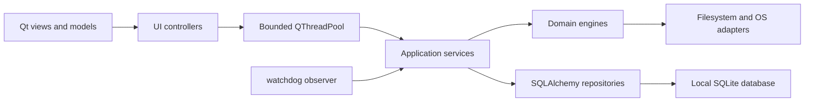

# DiskSense architecture

Phase 6 adds folder monitoring and storage history to the scanner, analytics, duplicate review, and audited cleanup. The contracts below use Python domain values such as `Path`, immutable dataclasses, integer byte counts, UTC timestamps, and opaque record IDs.

The diagram shows the target architecture. Phase 2 uses `ScanController` to schedule jobs on a dedicated one-thread pool. `ScanService` coordinates the inventory and repository. The scanner depends on the Python standard library, and Qt widgets consume immutable progress and summary records on the main thread.

## Module contracts

| Module | Proposed interface | Semantics |
| --- | --- | --- |
| Scanner | `ScanService.scan(root, incremental, control, report) -> ScanSummary` | An incremental scan compares against the latest complete inventory for the same normalized path. The service writes bounded batches. Cooperative controls expose pause, resume and cancel. Progress reports counts, sizes, elapsed time, and skipped entries. The UI derives a rate from counts and elapsed time. |
| Explorer | `InventoryReader.read(query) -> InventoryResult` | Return a page of up to 200 entries plus an optional folder overview containing aggregates, chart inputs, and live volume capacity. Keyset cursors use the selected sort value and the full relative path as a stable tie-breaker. |
| Duplicates | `DuplicateService.detect(request, control, report) -> DuplicateReport`; `DuplicateStore.members(run_id, group_id, after, keep) -> MembersPage` | Narrow candidates by size, sampled xxHash and streamed SHA-256. Provide checked previews, comparison, and one keeper per group. Phase 5 will repeat byte verification before any duplicate-based removal. |
| Cleanup | `CleanupService.preview(scan_id, rules, paths) -> CleanupPlan`; `execute(token, control) -> CleanupAudit` | Confirmation binds to a single-use preview token. Revalidate each eligible file before recycling and audit each outcome. |
| Monitor | `MonitorService.configure(...)`; `poll(selected, control, force=...)`; `remove(root_id)` | Keep watch settings, normalize filesystem events, reconcile folder totals, and report new growth alerts. |
| Recommendations | `Rule.evaluate(context, thresholds) -> Iterable[Recommendation]`; `dismiss(recommendation_id)` | Rules emit stable keys, evidence, explanation, risk and optional estimated savings. Query context exposes bounded aggregates and candidate pages. Persist dismissals against the evidence fingerprint. |
| Platform | `stat_entry(path) -> EntryIdentity`; `volume_usage(path) -> VolumeUsage`; `recycle(validated_target) -> RecycleOutcome` | Isolate filesystem identity, reparse-point handling, allocation support and native recycle operations. Return explicit results for unsupported operations and uncertain outcomes. |

Keep core modules independent of Qt and SQLAlchemy. Use protocols at I/O boundaries when an implementation and a test double need the same contract. Controllers submit jobs to a bounded pool and deliver results via queued Qt signals. Qt models change only on the main thread. Throttle progress updates and ignore stale responses after query or scan selection changes. Use a shutdown coordinator that cancels work, unpauses workers, stops observers, and drains or closes resources in ownership order.

## SQLite design

| Records | Important keys and indexes |
| --- | --- |
| `scans` | ID, normalized root, state, baseline, timestamps and counts. Index root and completion time. |
| `entries` | Primary key `(scan_id, path)` with a foreign key to `scans` and cascading deletion. A kind column distinguishes files and directories. Relative paths use slash separators, and the root path is the empty string. Directory rows store subtree file counts, observed logical bytes, and an incomplete flag. Index scan plus parent, size, extension, and modification time for explorer queries. |
| `duplicate_runs`, `duplicate_groups`, `duplicate_members` | Schema version 2. A run references its scan. Staged members are keyed by run and relative path. Index size/sample and size/full digest. Published groups store counts, potential savings and keeper choice. |
| `hash_cache` | Absolute path key, versioned file fingerprint, sample digest, optional full digest, and last access. Prune records after 30 days and retain up to 250,000 entries after a successful run. |
| `cleanup_operations`, `cleanup_items` | Schema version 3. Plan ID, approval time, scope, reason, result, and native error. Index operation and timestamp. Audit survives scan pruning and is retained for 365 days. |
| `watch_roots`, `watch_events`, `storage_snapshots` | Watch preferences and alert baselines, indexed per-root event history, and snapshot totals and reconciliation status. |
| `recommendations`, `settings` | Stable recommendation key and evidence fingerprint with dismissal state. Unique settings key with validated typed values. |

SQLite uses `PRAGMA user_version`, foreign keys, WAL, and a five-second busy timeout. The application acquires a per-database `QLockFile` before migration or interrupted-run recovery. A single Qt worker serializes database work. SQLAlchemy sessions are short-lived, and scan batches contain up to 512 rows. The scan's final transaction publishes a completed or partial snapshot. Cancellation and failure discard staged rows, while abandoned running scans are marked interrupted at next database open. Future analytics should filter snapshot states explicitly. [SQLAlchemy SQLite dialect](https://docs.sqlalchemy.org/en/20/dialects/sqlite.html)

Incremental scans create new snapshots and compare files by relative path and captured metadata using indexed SQL joins. Each comparison revisits the live filesystem. Metadata-only comparisons cannot establish content changes that preserve the recorded metadata. Partial scans suppress change counts because inaccessible entries could be mistaken for removals.

The database stores metadata in the per-user application data directory. The sidebar preference stays in QSettings. Retention defaults to the five latest finished attempts per root plus the latest complete scan if it falls outside that window. The repository accepts a different limit. Old snapshot entries are pruned in the same transaction as their scan rows. Baseline IDs remain in summaries after pruning so historical change counts retain their reference. Later phases will add separate retention for hash cache, monitoring, and cleanup history.

## Explorer queries

The explorer gets pages from completed or partial snapshots. Unfiltered navigation uses the parent-path index. Recursive filtering uses the relative-path prefix range and returns bounded pages. The largest-file query can use the size index. Path substring matching and file type aggregation can traverse a large scope, so both run on the background worker. The UI refreshes aggregates when the folder or snapshot changes and reuses them for paging, sorting, and filtering within a folder.

The Qt table model holds one page at a time. The tree keeps the selected branch and the first 100 immediate folders at its leaf. Charts show up to twelve leading entries per view. The treemap allocates remaining bytes to an “Other items” tile. The same overview drives the Dashboard and Explorer charts. Live capacity uses the selected scan root with `shutil.disk_usage`, so those values can change independently of the saved inventory. The single worker finishes an ongoing scan before serving a pending browse query.

## Duplicate detection and review

SQLite stages paths whose inventory size is shared by another file. The worker reads those paths in batches of 128. It samples small files once and larger files at their beginning, middle and end. Size and matching xxHash samples narrow the inputs for SHA-256, which reads 1 MiB at a time. Only completed runs appear in the UI. Each published group and member page contains up to 75 rows. Cancellation preserves the previous result. The next database open discards incomplete runs.

Before and after hashing or previewing, the worker checks path components and file metadata. It compares the open handle with the saved inventory and rechecks the path after the read. The cache fingerprint includes file identity, size, modification time and a change token. Windows reads `ChangeTime` from the open file handle. The worker bypasses the cache when file identity or the change token is missing. Digests and metadata are stored locally. Preview contents exist in memory only. [Windows file metadata](https://learn.microsoft.com/en-us/windows/win32/api/winbase/ns-winbase-file_basic_info)

Known hard links collapse to a single physical copy. A group with only one known physical copy is omitted. The logical estimate includes only non-keeper files with known identity and a single link. The default prefers keeping a multiply linked or unidentifiable file when one exists. Allocated space can differ from logical size. A live byte comparison is a point-in-time observation, and any future cleanup must verify the keeper and candidates again.

## Monitoring and reconciliation

Schema version 4 adds watch settings, filesystem events, and storage snapshots. Each watch retains the latest 2,000 events and 2,000 samples. A watch can be paused while retaining its history. Enabled watches resume when DiskSense reopens. The monitor supports up to 32 folders.

Watchdog callbacks hand off create, modify, move, and delete events without touching SQLite or the GUI. The dispatcher queue holds up to 4,096 events and the worker handoff holds up to 2,048. A dropped event marks the affected watch stale and records an overflow marker. A dispatcher overflow marks all enabled watches stale because it occurs before dispatch identifies the watch. Recent repeated modifications for the same path are debounced. DiskSense excludes its own SQLite files and lock from monitoring.

A two-second Qt timer requests work on the existing storage worker. Each turn reconciles at most one folder. Event hints can advance the next sample, and periodic inventory scans also run on quiet folders to account for missed events. The storage chart uses complete samples, while the list identifies incomplete or unavailable samples. Growth alerts compare against the saved baseline and honor a persisted cooldown. Alerts appear in the app and stay visible in sample history. Monitoring relies on the running DiskSense process. [Watchdog API](https://python-watchdog.readthedocs.io/en/stable/api.html)

## Cleanup execution and recovery

Candidate discovery uses saved file metadata and published duplicate groups. The cleanup worker previews at most 100 selected entries and captures the live file fingerprint before enabling confirmation. Each preview token expires after ten minutes and can run once. The worker blocks protected paths, reparse points, unknown file versions, multiply linked files and saved duplicate keepers. It compares bytes with a separate, current keeper before recycling a duplicate. Empty folders remain review-only because a directory could acquire children while a request is in flight.

Windows cleanup uses `IFileOperation` on fixed local drives with `FOFX_RECYCLEONDELETE`. The adapter holds parent directory handles without delete sharing and revalidates before invoking the operation. The Shell still accepts a path-based item, so the final check and the Shell operation are separate steps. The adapter treats inconclusive outcomes as indeterminate. [Windows Shell operation flags](https://learn.microsoft.com/en-us/windows/win32/api/shobjidl_core/nf-shobjidl_core-ifileoperation-setoperationflags)

SQLite commits the operation and approved items before calling the Shell. It records an attempt immediately before dispatch and records the outcome afterward. At database open, pending items from interrupted operations become skipped. Items interrupted during a Shell attempt become indeterminate and require inspection of Recycle Bin. Other operating systems can display candidate lists and previews.

## Traversal and cancellation

Depth-first traversal keeps one open iterator per active directory and one bounded write batch. It skips symlinks, Windows reparse points, repeated ancestor identities, cross-volume descendants, and special files. Windows uses a separate stat call to obtain file identity and link counts. Extended Win32 paths support long paths without changing system settings. POSIX allocated byte counts derive from filesystem block counts. Both size measures sum per path. [Python filesystem metadata](https://docs.python.org/3/library/os.html#os.DirEntry.stat), [Windows path limits](https://learn.microsoft.com/en-us/windows/win32/fileio/maximum-file-path-limitation)

Scans inventory a live tree. Files can move or change after observation, and an inaccessible entry makes the inventory partial. An unavailable or replaced root causes the scan to fail rather than publish a snapshot. Pause and cancellation take effect at cooperative checkpoints. An operating-system call already in progress must return before the worker can respond. After traversal, the final SQLite transaction completes once publication begins.

## Architecture decisions

- **ADR 001 · Qt Widgets and Qt Model/View.** Native desktop interaction, keyboard navigation and virtualized models justify PySide6. Phase 1 uses PySide6 Essentials, which supplies the Qt modules the shell imports. Use a lightweight custom Qt widget for the treemap and cap rendered nodes by viewport size. Introduce filesystem and database dependencies with their respective features.
- **ADR 002 · SQLite snapshots through SQLAlchemy.** Local snapshots support offline exploration and keep queries independent of live filesystem latency. The disk cost grows with inventory history, so use indexed bounded queries, measured retention, and transactional pruning.
- **ADR 003 · Recycle through the platform adapter.** Native recycling preserves recovery options when the platform reports support. If scope, identity or recycling capability is uncertain, skip the item and audit the outcome. Keep all operations local and avoid shell execution or elevated privileges.

## Technical risks

| Risk | Planned response |
| --- | --- |
| Windows junctions, links, mount points, Unicode and long paths | Reject unsafe traversal during cleanup and skip reparse points during scanning unless explicitly supported. Test native path behavior with isolated fixtures and removable-volume failure injection. |
| Files changed or replaced between preview, validation and recycling | Revalidate path components, identity and metadata immediately before mutation. Use native identity checks where available. Evaluate the remaining race window of the native recycle API before enabling operations. |
| Duplicate hashes and hard links | Use cached hashes as candidate evidence. Confirm live equality before removing a copy, reserve a validated keeper, and estimate freed allocation only when the final link count can be established. |
| Memory and latency with millions of entries | Bound work queues, batches, result pages and chart inputs. Index representative filters and measure memory as file counts scale. |
| Live database contention and interrupted scans | Use WAL, short writes and explicit state transitions. Exercise crash recovery and reads during writes. |
| Watchdog event loss and feedback loops | Bound and debounce ingress, exclude application data, surface stale snapshots, and use periodic reconciliation even when the backend cannot report overflow. |
| Recycle Bin varies across drives and platforms | Test capability and failure handling on each supported volume type. Disable action on unsupported volumes and provide recovery instructions based on the actual outcome. |
